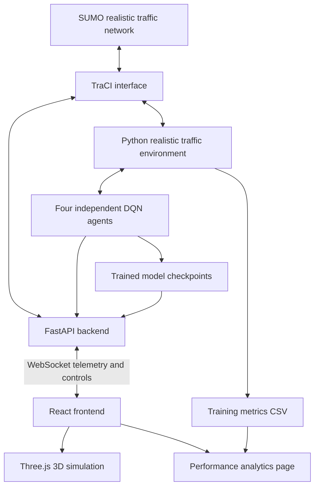

# NeuroFlow Traffic AI — Multi-Agent Reinforcement Learning for Traffic Signal Optimization

A SUMO-based traffic-signal control project that uses four independent Deep Q-Network (DQN) agents to make traffic-light decisions at four connected intersections. A FastAPI backend communicates with SUMO through TraCI and streams live simulation data to a React and Three.js frontend for 3D visualization and performance monitoring.

> **Active application:** SUMO + TraCI + Independent DQN agents + FastAPI/WebSocket + React/Three.js.  
> The older Streamlit files under `app/` are retained in the repository for reference only; they are not part of the recommended run workflow.

---

## Contents

- [Project at a glance](#project-at-a-glance)
- [System architecture](#system-architecture)
- [Main features](#main-features)
- [Technology stack](#technology-stack)
- [Repository structure](#repository-structure)
- [Requirements](#requirements)
- [Installation](#installation)
- [Train the realistic MARL agents](#train-the-realistic-marl-agents)
- [Run the 3D application](#run-the-3d-application)
- [Run a standalone SUMO/MARL demonstration](#run-a-standalone-sumomarl-demonstration)
- [Analytics and generated files](#analytics-and-generated-files)
- [DQN environment and control design](#dqn-environment-and-control-design)
- [Traffic network](#traffic-network)
- [Interactive controls](#interactive-controls)
- [Evaluation notes and limitations](#evaluation-notes-and-limitations)
- [Troubleshooting](#troubleshooting)

## Project at a glance

The project models a small connected urban road network containing four signalized intersections, identified as `I1`, `I2`, `I3`, and `I4`. Each intersection has its own DQN agent. The agents receive local traffic-state information from SUMO and select one of two actions: keep the current signal phase or request a phase switch.

SUMO remains the authoritative simulation engine. Vehicle positions, speeds, lanes and traffic-light states are read from SUMO through TraCI; the browser displays that live information and does not independently simulate or control vehicle motion.

The main live application uses the realistic network and configuration in:

```text
simulation/realistic_config/realistic.sumocfg
```

The repository also contains an earlier, smaller network and several legacy training/evaluation scripts. The recommended current workflow is the realistic training and application workflow documented below.

## System architecture



### Runtime responsibilities

| Component | Responsibility |
|---|---|
| SUMO | Advances vehicles and traffic-light programs in the microscopic traffic simulation. |
| TraCI | Lets Python read traffic information and issue permitted traffic-signal commands. |
| `RealisticTrafficEnv` | Reads intersection state, applies agent actions, advances SUMO and calculates rewards. |
| DQN agents | Select `HOLD` or `SWITCH` for their assigned intersections. |
| FastAPI | Hosts the status and analytics endpoints and the live simulation WebSocket. |
| React + Three.js | Renders the 3D network, vehicles, signals, dashboard and camera controls. |
| Analytics page | Displays live intersection-agent statistics and training history when the relevant CSV exists. |

## Main features

### Traffic simulation and MARL

- Four connected, signalized intersections: `I1`–`I4`.
- Multiple lanes in each direction on the realistic road network.
- Car, bus and truck vehicle types with predefined routes and traffic flows.
- One independent DQN agent per intersection.
- Local traffic measurements include queue length, accumulated waiting time and vehicle count, together with the current signal phase and phase elapsed time.
- A minimum-green guard is used before an agent-requested phase switch. SUMO continues to manage the programmed signal transitions, including yellow phases.

### 3D visualization

- React, Three.js, React Three Fiber and Drei-based rendering.
- Detailed vehicles, roads, lane markings, traffic lights and intersection geometry.
- Buildings, trees, sidewalks and street lamps.
- Day, dusk and night visual themes.
- Overview and individual-junction camera presets.
- Free mouse camera movement after choosing a preset.
- Vehicle selection and a telemetry inspector.

### Live dashboard

- Simulation time, active vehicle count, average speed, arrived-vehicle count, queue and waiting-time indicators.
- MARL agent status for the four intersections.
- Pause/resume, simulation playback speed, MARL/fixed-time mode selection and reset controls.
- A rush-hour surge control that attempts to insert 12 additional vehicles into the running simulation.

### Performance analytics

The **ANALYTICS** page includes:

- Live queue-length and accumulated-waiting-time trends for the four agents.
- Per-agent averages for queue, waiting time, monitored vehicles and reward.
- An intersection-agent comparison table, including switch-decision counts and sample counts.
- Training-history charts for average queue, episode reward, average waiting time and average speed when `results/realistic_marl_training_metrics.csv` is available.
- A warning when one or more trained model checkpoints have not been loaded.

Live agent scorecard samples are recorded only while the backend is in `MARL` mode. Fixed-time intervals are excluded from those agent averages. These charts compare the four intersection agents; they are not, by themselves, a controlled MARL-versus-fixed-time experiment.

## Technology stack

| Area | Technology used in this repository |
|---|---|
| Programming language | Python |
| Traffic simulator | SUMO 1.27.1 |
| Simulator interface | TraCI / SUMO tools |
| RL environment | Custom Python environment in `environment/realistic_traffic_env.py` |
| RL algorithm | Deep Q-Network (DQN) |
| Multi-agent arrangement | Independent DQN, one agent per intersection |
| Neural-network library | PyTorch |
| Data handling | NumPy, Pandas and Python CSV utilities |
| Backend | FastAPI and Uvicorn |
| Live communication | WebSocket |
| Frontend | React and Vite |
| 3D rendering | Three.js, React Three Fiber and Drei |

## Repository structure

```text
MARL-Traffic-Optimization-main/
│
├── agents/
│   ├── dqn_agent.py                 # DQN agent: action selection, memory, training and checkpoints
│   ├── dqn_network.py               # Neural network used to estimate Q-values
│   └── replay_buffer.py             # Experience replay buffer
│
├── environment/
│   ├── realistic_traffic_env.py     # Main four-intersection SUMO environment
│   ├── traffic_env.py               # Earlier/compact environment implementation
│   └── __init__.py
│
├── training/
│   ├── train_realistic_marl.py      # Recommended realistic-network training entry point
│   ├── train_marl.py                # Earlier MARL training script
│   ├── train.py                     # Earlier single-agent training script
│   └── config.py                    # Earlier training configuration
│
├── evaluation/
│   ├── fixed_time_baseline.py       # Fixed-time run on the earlier compact SUMO configuration
│   ├── evaluate_marl.py             # Earlier MARL evaluation script
│   ├── evaluate.py                  # Earlier evaluation script
│   └── compare_results.py           # Legacy comparison using values embedded in the script
│
├── simulation/
│   ├── realistic_network/           # Realistic network source and generated SUMO network
│   ├── realistic_routes/            # Routes, vehicle types and traffic flows
│   ├── realistic_config/            # Active realistic SUMO configuration
│   ├── network/                     # Earlier/compact network files
│   ├── routes/                      # Earlier/compact route files
│   ├── scripts/                     # Environment, action and MARL demonstration scripts
│   └── simulation.sumocfg           # Earlier/compact SUMO configuration
│
├── backend/
│   └── main.py                      # FastAPI, TraCI control and WebSocket server
│
├── frontend/
│   ├── src/
│   │   ├── App.jsx                  # Main 3D simulation and dashboard
│   │   ├── AnalyticsPage.jsx        # Performance analytics page
│   │   ├── AnalyticsPage.css        # Analytics page styles
│   │   ├── App.css                  # Main application styles
│   │   └── index.css                # Global styles
│   ├── package.json
│   └── vite.config.js
│
├── visualization/                   # Plotting scripts for legacy result files
├── app/                             # Legacy Streamlit files; not the active UI
├── requirements.txt                 # Python dependency pins
├── test_sumo.py                     # SUMO installation/smoke test
└── README.md
```

## Requirements

Install the following software before running the project:

1. **Python 3.10** (the project has been developed/tested with the Python 3.10 environment).
2. **SUMO 1.27.1**, including `sumo`, `sumo-gui`, `netconvert` and the SUMO tools.
3. **Node.js and npm** for the React/Vite frontend.
4. **Git** (optional, for cloning and version control).

A CUDA-capable NVIDIA GPU can be used by PyTorch when a compatible driver and CUDA-enabled PyTorch build are available. The DQN agent automatically selects CUDA when `torch.cuda.is_available()` is true; otherwise it uses the CPU.

### Verify SUMO

Open PowerShell and check that SUMO commands are available:

```powershell
sumo --version
sumo-gui --version
netconvert --version
```

The repository's Python requirements include `traci` and `sumolib`. If SUMO commands or its Python tools are not found, configure `SUMO_HOME` to your SUMO installation directory and add the SUMO `bin` directory to `PATH`. For a local PowerShell session, adjust the example path to the location on your computer:

```powershell
$env:SUMO_HOME = "C:\Program Files (x86)\Eclipse\Sumo"
$env:Path = "$env:SUMO_HOME\bin;$env:Path"
$env:PYTHONPATH = "$env:SUMO_HOME\tools;$env:PYTHONPATH"
```

Then verify Python can import TraCI:

```powershell
python -c "import traci, sumolib; print('TraCI and sumolib are available')"
```

## Installation

Run the commands from the repository root (`MARL-Traffic-Optimization-main`). The examples below use Windows PowerShell.

### 1. Create and activate a Python virtual environment

```powershell
py -3.10 -m venv .venv
.\.venv\Scripts\Activate.ps1
python -m pip install --upgrade pip
```

If PowerShell blocks virtual-environment activation, use the Python executable directly as `.\.venv\Scripts\python.exe`, or adjust the execution policy for your user account according to your organization's requirements.

### 2. Install Python dependencies

The repository pins its Python dependencies in `requirements.txt`. The file includes CUDA 13.0 PyTorch package pins; the extra index below allows pip to find those PyTorch wheels while retaining the default Python Package Index for other dependencies:

```powershell
python -m pip install --extra-index-url https://download.pytorch.org/whl/cu130 -r requirements.txt
```

If you need a CPU-only PyTorch installation or a different CUDA build, the three PyTorch package pins (`torch`, `torchvision` and `torchaudio`) must be replaced with mutually compatible builds for your Python version and hardware. Use the official PyTorch installation selector to choose the appropriate builds.

### 3. Install frontend dependencies

```powershell
cd frontend
npm ci
```

Return to the repository root before running Python scripts:

```powershell
cd ..
```

## Train the realistic MARL agents

The recommended training entry point for the four-intersection realistic network is:

```powershell
python training\train_realistic_marl.py
```

This script:

- loads `simulation/realistic_config/realistic.sumocfg`;
- starts SUMO in command-line mode (`use_gui=False`);
- creates four independent DQN agents for `I1`, `I2`, `I3` and `I4`;
- uses a five-value state and a two-action space;
- trains for 75 episodes, with a maximum of 1,000 steps per episode;
- updates the target networks every five episodes;
- saves intermediate checkpoints every 25 episodes;
- saves the final checkpoints and episode metrics when training finishes.

Training can take a substantial amount of time depending on the computer, SUMO traffic demand and whether PyTorch can use the GPU. Keep the terminal open until the script reports that training has completed.

### Files produced by training

The script creates these folders when needed:

```text
models/
├── marl_I1_final.pth
├── marl_I2_final.pth
├── marl_I3_final.pth
├── marl_I4_final.pth
└── realistic/
    ├── marl_I1_final.pth
    ├── marl_I2_final.pth
    ├── marl_I3_final.pth
    └── marl_I4_final.pth

results/
└── realistic_marl_training_metrics.csv
```

It also saves episode checkpoints under `models/realistic/` at the configured save intervals.

> **Model availability:** Model checkpoints and result folders are excluded by `.gitignore` and are not included in the source ZIP by default. A fresh clone therefore does not automatically contain trained agents or training charts. Train the agents, or obtain the matching checkpoint files separately, before describing a live run as using trained DQN models.

## Run the 3D application

The backend and frontend must run in two separate terminals on the same computer. The frontend currently connects to `127.0.0.1`, so this setup is intended for a local demonstration.

### Terminal 1 — Start the backend

From the repository root, activate the virtual environment and run:

```powershell
.\.venv\Scripts\Activate.ps1
python backend\main.py
```

The backend runs at `http://127.0.0.1:8000`. It starts the realistic SUMO-GUI simulation when the browser establishes the WebSocket connection.

Available backend routes:

| Address | Purpose |
|---|---|
| `http://127.0.0.1:8000/` | Backend status JSON |
| `http://127.0.0.1:8000/api/analytics` | Training history, live agent comparison and model-load status |
| `ws://127.0.0.1:8000/ws/simulation` | Live simulation telemetry and browser commands |

### Terminal 2 — Start the frontend

```powershell
cd frontend
npm run dev
```

Open the local Vite address printed in the terminal. It is normally:

```text
http://localhost:5173
```

The browser connects to the backend WebSocket, and the backend launches SUMO-GUI. Keep both terminals running while using the application.

### Model loading behaviour

At backend startup, each intersection agent looks for its final checkpoint in either of these locations:

```text
models/realistic/marl_I1_final.pth
models/realistic/marl_I2_final.pth
models/realistic/marl_I3_final.pth
models/realistic/marl_I4_final.pth
```

or directly under `models/` with the same filenames. If a checkpoint is missing or cannot be loaded, the backend prints a warning and uses an initialized DQN network for that intersection. The dashboard and analytics page expose model-load status. **A run using initialized networks must not be reported as a trained-agent evaluation.**

## Run a standalone SUMO/MARL demonstration

After training and confirming that all four final model files exist directly under `models/`, run:

```powershell
python simulation\scripts\run_realistic_marl.py
```

This script opens SUMO-GUI, loads the four final checkpoints, sets each agent's exploration rate to zero and runs a demonstration for up to 1,000 environment steps.

To check the realistic environment without loading trained models, run:

```powershell
python simulation\scripts\test_realistic_env.py
```

This test uses `HOLD` actions for the four intersections and prints periodic queue, waiting-time and vehicle-count measurements. It is an environment smoke test, not a trained MARL performance evaluation.

A basic SUMO installation smoke test is also available:

```powershell
python test_sumo.py
```

## Analytics and generated files

The **ANALYTICS** button in the frontend opens the performance analytics page. It obtains data from `GET /api/analytics`.

| Data | Source | When available |
|---|---|---|
| Live agent comparison | SUMO/TraCI measurements collected by the backend | After the live simulation runs in `MARL` mode |
| Live queue trend | Bounded in-memory live history in the backend | During the current backend/SUMO session |
| Live waiting trend | Bounded in-memory live history in the backend | During the current backend/SUMO session |
| Training queue/reward/waiting/speed curves | `results/realistic_marl_training_metrics.csv` | After `training/train_realistic_marl.py` has written metrics |
| Model-load warning | Backend checkpoint-load status | When one or more final checkpoints are absent or fail to load |

The training CSV contains these columns:

```text
episode,reward,average_queue,average_waiting,average_speed,average_vehicles
```

Live agent averages and trend points reset when the backend starts a new SUMO session or the simulation is reset. The live waiting value is measured for vehicles on the incoming roads monitored by each intersection. The live reward uses the environment's queue and waiting-time-change objective. The reported switch count is the agent's requested `SWITCH` action count; it is not necessarily the number of signal changes accepted by SUMO's minimum-green guard.

## DQN environment and control design

The active environment is implemented in `environment/realistic_traffic_env.py`.

### Agents

There are four independent DQN agents, one for each traffic-light ID:

```text
I1  I2
I3  I4
```

Each agent uses its own local intersection measurements. The current implementation is **Independent DQN**; it does not implement centralized training, a shared joint policy or explicit inter-agent message passing.

### State representation

The environment returns a five-element normalized state vector for each intersection:

| Element | Meaning | Normalization in source code |
|---|---|---|
| 1 | Queue length | `min(queue / 100, 1)` |
| 2 | Accumulated waiting time | `min(waiting / 1000, 1)` |
| 3 | Number of vehicles on monitored incoming roads | `min(vehicle_count / 100, 1)` |
| 4 | Current traffic-light phase | `min(phase / 10, 1)` |
| 5 | Time elapsed in the current phase | `min(phase_time / 60, 1)` |

### Actions

Each agent chooses one of two actions:

| Action | Meaning |
|---|---|
| `0` | `HOLD` — keep the current signal phase |
| `1` | `SWITCH` — request a transition to the next programmed phase, subject to the minimum-green guard |

The realistic environment uses a minimum green time of 10 seconds by default. The traffic-light program in the generated SUMO network contains green and yellow phases; the environment does not replace SUMO's vehicle simulation.

### Reward

The reward implemented by the realistic environment is:

```text
reward = -(queue + 0.05 × waiting_time_change)
```

A smaller queue contributes to a better reward. An increase in accumulated waiting time is penalized through the waiting-time-change term. Reward is calculated separately for each intersection agent.

### DQN network and learning

The DQN network in `agents/dqn_network.py` is a feed-forward neural network with two hidden layers of 128 units, ReLU activations and one output per action. The agent implementation also contains a target network, replay memory, an Adam optimizer and an epsilon-greedy action-selection policy.

The active realistic training script sets the learning rate to `0.0005`, discount factor (`gamma`) to `0.99`, batch size to `64`, starting epsilon to `1.0`, minimum epsilon to `0.05` and epsilon decay to `0.995`. The script uses 75 episodes and up to 1,000 steps per episode.

## Traffic network

The active SUMO configuration is `simulation/realistic_config/realistic.sumocfg`. It points to:

```text
simulation/realistic_network/realistic.net.xml
simulation/realistic_routes/realistic.rou.xml
```

The generated network contains the four controlled intersections `I1`–`I4` connected by horizontal and vertical road corridors. The edge source file defines three lanes per directed road edge and a nominal road speed of 16.7 m/s. The route file defines car, bus and truck vehicle types, route alternatives and traffic flows. The SUMO configuration is set to simulate from time 0 to 3,600 seconds.

### Optional network regeneration

The generated network file is already included. Regenerate it only after modifying the node or edge source files:

```powershell
netconvert --node-files simulation\realistic_network\realistic.nod.xml --edge-files simulation\realistic_network\realistic.edg.xml --output-file simulation\realistic_network\realistic.net.xml
```

Then verify it in SUMO-GUI:

```powershell
sumo-gui -c simulation\realistic_config\realistic.sumocfg
```

## Interactive controls

The main simulation toolbar provides the following controls:

| Control | Behaviour |
|---|---|
| Pause / Resume | Pauses or resumes SUMO stepping while keeping the connection alive. |
| Speed | Selects `0.5x`, `1x`, `2x` or `4x` playback speed. |
| Mode | Switches between `MARL` and the simulation's `FIXED` mode. |
| Rush Hour Surge | Requests insertion of 12 additional vehicles into the running simulation. |
| Reset | Resets the current SUMO episode and live analytics counters. |
| View | Selects `Overview` or a close-up of `Junction 1` through `Junction 4`. |
| Theme | Selects `DAY`, `DUSK` or `NIGHT` lighting. |
| Analytics | Opens the agent and training performance page. |

Free mouse controls remain available after selecting a camera preset:

- **Left mouse drag:** rotate the camera.
- **Right mouse drag:** pan/move the camera.
- **Mouse wheel:** zoom in or out.
- **Middle mouse drag:** dolly/zoom.

## Evaluation notes and limitations

The repository contains earlier evaluation scripts under `evaluation/`. They should be treated carefully when preparing formal performance claims:

1. `evaluation/fixed_time_baseline.py` uses `simulation/simulation.sumocfg`, the earlier compact configuration.
2. `evaluation/evaluate_marl.py` also points to the earlier compact configuration and uses the earlier environment path.
3. `evaluation/compare_results.py` contains metric values directly in the source code. It does not read a new matched pair of evaluation runs before calculating its comparison.
4. These scripts do not establish a reproducible fixed-time-versus-MARL comparison on the active realistic four-intersection network with identical traffic demand, simulation duration and random seeds.

For a defensible comparison, both controllers must be evaluated on the same network and route demand, with the same simulation horizon and controlled random seeds. Report the experiment configuration and repeat runs where possible. Do not use the hard-coded values in `compare_results.py` as fresh experimental results.

Other limitations of the current implementation include:

- The four agents make independent decisions. Explicit communication or coordinated joint policy learning is not implemented.
- The project is a SUMO simulation and does not directly operate real-world traffic lights.
- The live analytics scorecard compares the four intersection agents; it does not prove that one agent is globally better for the full road network.
- Model checkpoints and training results are local generated artifacts and are not committed by default.
- The live application uses loopback URLs (`127.0.0.1`) and is configured for a local demonstration, not remote multi-user deployment.
- The browser displays up to 120 detailed vehicles; SUMO may be simulating more vehicles than are drawn in the 3D scene.

## Troubleshooting

### `sumo` or `sumo-gui` is not recognized

Confirm that SUMO 1.27.1 is installed and that its `bin` directory is on `PATH`. Set `SUMO_HOME` to the installation directory, then reopen PowerShell and check `sumo --version` and `sumo-gui --version`.

### Python cannot import `traci`

Activate the project's `.venv`, install the requirements, and verify that the SUMO Python tools are available. If required by the installation, add `$env:SUMO_HOME\tools` to `PYTHONPATH` for the active PowerShell session.

### Backend starts, but the frontend shows `OFFLINE`

Make sure the backend is running at `127.0.0.1:8000`, then reload the Vite page. The frontend uses `ws://127.0.0.1:8000/ws/simulation`; this address is intended for a frontend and backend running on the same computer.

### SUMO-GUI does not appear

The GUI simulation is created when a browser WebSocket client connects. Confirm `sumo-gui` is available from the same shell/environment that starts the backend and inspect the backend terminal for TraCI or SUMO errors.

### Backend warns that a trained model is missing

Run `python training\train_realistic_marl.py` to train the four realistic agents, or place the corresponding final `.pth` files in `models/realistic/` or `models/`. Confirm the filenames match `marl_I1_final.pth` through `marl_I4_final.pth`.

### Analytics training charts are empty

The training charts read `results/realistic_marl_training_metrics.csv`. Run the realistic training script and allow it to write the CSV. Live agent trends require a running backend and samples collected while the control mode is `MARL`.

### `npm` reports that `package.json` cannot be found

Run frontend commands from the `frontend` directory:

```powershell
cd frontend
npm ci
npm run dev
```

### The frontend is running but the browser cannot reach the backend

The current frontend API and WebSocket URLs are fixed to `127.0.0.1`. Run both processes on the same computer. If you change the host or port, update the URLs in `frontend/src/App.jsx` and `frontend/src/AnalyticsPage.jsx` to match the backend.

---

## Reproducibility reminder

For a reproducible project demonstration, record the SUMO version, Python version, dependency versions, model checkpoint filenames, network/configuration files, control mode, simulation duration and traffic-demand setup. Keep the trained `.pth` files and generated CSV results with the experiment artifacts, even if they are excluded from Git.
